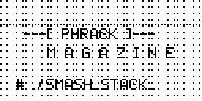
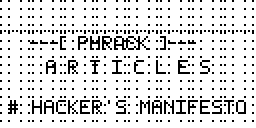
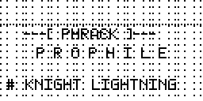

# Phrack

**Underground history, 128 × 64 pixels.**

Three animated Flipper Zero screens inspired by [Phrack](https://phrack.org):
terminal lettering, moving scanlines, and a shared five-frame glitch rhythm.
The firmware's normal icons, menus, and fonts stay in place.

| Magazine | Articles | Prophile |
| :---: | :---: | :---: |
|  |  |  |
| Four terminal one-liners | Ten classic article titles | Ten names from hacker history |

Previews are two-second excerpts at the device's actual **10 fps**. Long titles
wrap onto two lines rather than shrinking the pixels.

**[Download the asset pack](https://github.com/flipper-hero/phrack-theme/releases/latest/download/Phrack.zip)**
· [Legacy dolphin layout](https://github.com/flipper-hero/phrack-theme/releases/latest/download/Phrack-dolphin.zip)
· [Editable PNG pack](https://github.com/flipper-hero/phrack-theme/releases/latest/download/Phrack-source.zip)

## Install

### Momentum / RogueMaster

1. Download `Phrack.zip` from the [latest release](https://github.com/flipper-hero/phrack-theme/releases/latest).
2. Extract it and upload the `Phrack` folder with qFlipper to `SD/asset_packs/`.
3. Select **Phrack** in your firmware's asset-pack settings and let it restart.

The resulting path is `SD/asset_packs/Phrack/Anims/manifest.txt`.

Updating an older Phrack pack? Remove its old `Icons` folder so the firmware's
normal icons return. This release contains only animations and their license.

### Unleashed / official firmware

`Phrack-dolphin.zip` provides the same animations in the standard `SD/dolphin`
layout. If you already have custom animations, add the three Phrack folders and
merge their entries into your existing `dolphin/manifest.txt`.

| Firmware | Installation layout | Verification |
| --- | --- | --- |
| Momentum | `SD/asset_packs/Phrack/Anims` | All three screens tested on a physical Flipper Zero |
| RogueMaster | `SD/asset_packs/Phrack/Anims` | Asset-pack loader and documentation checked; device test welcome |
| Unleashed | `SD/dolphin` | Animation loader checked; device test welcome |
| Official firmware | `SD/dolphin` | Animation loader checked; device test welcome |

Installation follows the [asset-pack documentation](https://github.com/Next-Flip/Momentum-Firmware/blob/dev/documentation/file_formats/AssetPacks.md)
and [standard animation format](https://github.com/flipperdevices/flipperzero-firmware/blob/dev/assets/dolphin/ReadMe.md).
These are compatibility claims, not claims of inclusion or endorsement.

## Build and edit

Python **3.10+**, Pillow, and heatshrink2. No firmware checkout is required.

```sh
python3 -m venv .venv
. .venv/bin/activate
python -m pip install -r requirements.txt
python build.py
python -m unittest discover -s tests -v
```

`dist/` contains three reproducible ZIPs and `SHA256SUMS`. ZIP timestamps and file
order are fixed. Generated bitmap packs are release artifacts, not committed
source files.

- `assets/magazine/`: twenty tiny, editable one-bit PNGs preserve the original
  Magazine artwork and its per-frame glitches.
- `assets/theme.json`: article titles, profile names, animation timing, and
  manifest settings.
- `assets/font.json`: the native 5 × 7 bitmap alphabet for Articles and Prophile.
- `build.py`: renders the screens and writes the public Flipper bitmap format.

After editing, regenerate the README excerpts with:

```sh
python build.py --previews previews
```

Magazine holds each caption for one second; Articles and Prophile hold each for
two. All three keep the background moving at 10 fps. Firmware settings determine
when animations rotate; on Momentum, holding OK on the homescreen selects another
idle animation.

## For firmware maintainers

`Phrack-source.zip` contains native PNG frames, `meta.txt` files, and a manifest.
It can be unpacked into an asset-pack source directory such as `assets/packs/`
and compiled with the firmware's existing packer. Standard dolphin integrations
can import the three animation directories and merge the manifest entries.

There are **three screens, 120 unique frames, and no icon or font overrides**.
The generator checks native dimensions, glyphs, text bounds, and the firmware's
255-frame timeline limit. CI verifies bitmap round-trips, archive reproducibility,
metadata, and preview consistency. See [CONTRIBUTING.md](CONTRIBUTING.md).

## A small tribute

This pack is a thank-you to [Phrack](https://phrack.org) and everyone who writes,
edits, reviews, publishes, and preserves the magazine. Behind every issue are
people putting time, curiosity, and hard-won knowledge into something others can
learn from. That work has a way of staying with you.

For me, it comes back to one afternoon:

> I was taking a C course at a German Berufsschule when Aleph One's
> [Smashing the Stack for Fun and Profit](https://phrack.org/issues/49/smashing-the-stack-for-fun-and-profit_md.html#article)
> came out. Three buddies and I were huddled over a printout when one of our two
> programming teachers came over, expecting us to be up to no good. We handed him
> the paper. He was completely blown away too.
>
> We spent the rest of the class going through it with him, while the other
> teacher had to teach twenty-odd kids who didn't really give a damn. Four curious
> students, one curious teacher, and a printout. I still remember it all these
> years later.

*[Franz Bettag](https://github.com/fbettag), Flipper Hero*

Read the magazine. Follow the references. Keep being curious.

## License and provenance

Artwork, content configuration, previews, and generated packs are dedicated under
[CC0 1.0](LICENSE-ART). The generator, tests, workflows, and documentation use
[MIT](LICENSE). Both are [GPL-compatible](https://www.gnu.org/licenses/license-list.html#Expat),
with [CC0 specifically suitable for non-software artwork](https://www.gnu.org/licenses/license-list.html#CC0).
Distributors may bundle, modify, and redistribute the artwork; credit is welcome.

The artwork was created with AI assistance for Flipper Hero, and the generator
was developed with AI assistance. No article bodies, magazine scans, or firmware
code are bundled. Each upstream project decides what it accepts;
[Momentum currently prohibits AI-assisted contributions](https://github.com/Next-Flip/Momentum-Firmware/blob/dev/CONTRIBUTING.md).

An independent tribute by [Flipper Hero](https://github.com/flipper-hero).
Not affiliated with or endorsed by Phrack, Flipper Devices, or firmware maintainers.
